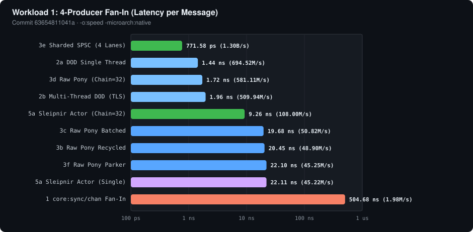
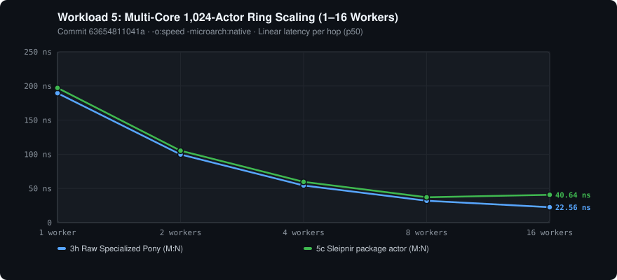
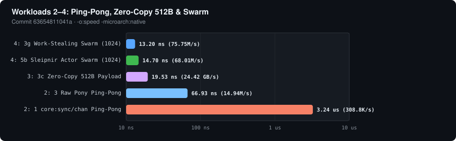

[Root README](../README.md) · **Suite Renders**

# Sleipnir Benchmarks & Visual Renders

Lock-free M:N Pony actor scheduler, wait-free Sharded SPSC mailbox, C11 reference, and official `libponyrt` (`0.77.2`) benchmark suite for **Sleipnir** (`25` benchmarks across `5` groups, `175` samples at commit `63654811041a` in [`history.hugidb`](history.hugidb)), with visual SVG charts rendered via [`runa`](https://github.com/boxxxie/runa) under [`renders/`](renders/).

---

## Visual Renders (`-o:speed`)

### 1. Workload 1: 4-Producer Fan-In Primitives (`2,000,000` Messages)



### 2. Workload 5: Multi-Core `1,024`-Actor Ring Scaling (`1`–`16` Workers)



### 3. Workloads 2–4: Ping-Pong, Zero-Copy `512B` Payload & `1,024`-Actor Swarm



---

## Reproducing & Regenerating Renders

```bash
# 1. Run the suite and append results to benchmarks/history.hugidb
hugi run benchmarks --runs 7 --warmup 1

# 2. Run a subset of workloads without modifying history.hugidb
hugi run benchmarks --overlay --runs 1 --groups workload_1_fan_in --filter spsc

# 3. Statistically compare the last two commits (Mann-Whitney U / Welch t-test)
hugi compare --last

# 4. Regenerate SVG charts in benchmarks/renders/ and tables below using runa AOT templates
odin run benchmarks/render -collection:runa=../runa

# 5. Optional: build official libponyrt (0.77.2) and run C11 / FFI comparison
./benchmarks/build_libponyrt.sh
odin run benchmarks/actor_benchmark.odin -file -o:speed -define:USE_LIBPONYRT=true \
  -extra-linker-flags:"-L.tmp/ponyc_build -lponyrt -Wl,-rpath,.tmp/ponyc_build -lpthread -ldl -lm -latomic"
gcc -O3 -march=native -pthread -DUSE_LIBPONYRT -I.tmp/ponyc_src/src/libponyrt -I.tmp/ponyc_src/src/common \
  benchmarks/actor_benchmark_c11.c -L.tmp/ponyc_build -lponyrt -Wl,-rpath,.tmp/ponyc_build -ldl -lm -latomic \
  -o .tmp/actor_benchmark_c11 && ./.tmp/actor_benchmark_c11
```

---

## Full Benchmark Results (`25` Benchmarks at `63654811041a`)

<!-- BEGIN_BENCHMARK_TABLE -->
### `workload_1_fan_in` — 4-Producer Fan-In (`2M` Messages) (`10` benchmarks)

Single-producer, batched `Chain=32`, Wait-Free Sharded SPSC, `core:sync/chan`, and DOD baselines.

| Benchmark | Median (`p50`) | `P95` | Throughput / Ops | `CV%` | Allocs / op |
| :--- | ---: | ---: | ---: | ---: | ---: |
| `1_chan_fan_in` | **504.68 ns** | 517.53 ns | 1.98M/s | 2.1% | **0** |
| `2a_dod_single_thread` | **1.44 ns** | 1.49 ns | 694.52M/s | 3.5% | **0** |
| `2b_dod_multithread_tls` | **1.96 ns** | 3.34 ns | 509.94M/s | 34.3% | **0** |
| `3b_self_pony_recycled_fan_in` | **20.45 ns** | 20.63 ns | 48.90M/s | 0.7% | **0** |
| `3c_self_pony_batched_fan_in` | **19.68 ns** | 20.08 ns | 50.82M/s | 2.0% | **0** |
| `3d_self_pony_chain32_fan_in` | **1.72 ns** | 1.78 ns | 581.11M/s | 3.6% | **0** |
| `3e_sharded_spsc_fan_in` | **771.58 ps** | 786.27 ps | 1.30B/s | 1.7% | **0** |
| `3f_self_pony_parker_fan_in` | **22.10 ns** | 22.39 ns | 45.25M/s | 1.0% | **0** |
| `5a_actor_pool_single_fan_in` | **22.11 ns** | 23.06 ns | 45.22M/s | 2.6% | **0** |
| `5a_actor_pool_chain32_fan_in` | **9.26 ns** | 9.81 ns | 108.00M/s | 6.0% | **0** |
### `workload_2_ping_pong` — 2-Actor Ping-Pong (`500K` Round-Trips) (`2` benchmarks)

Latency per hop across `core:sync/chan` vs raw Pony mailbox ring.

| Benchmark | Median (`p50`) | `P95` | Throughput / Ops | `CV%` | Allocs / op |
| :--- | ---: | ---: | ---: | ---: | ---: |
| `1_chan_ping_pong` | **3.24 us** | 3.35 us | 308.8K/s | 1.8% | **0** |
| `3_self_pony_ping_pong` | **66.93 ns** | 67.46 ns | 14.94M/s | 1.9% | **0** |
### `workload_3_large_payload` — `512 B` Zero-Copy `iso` Pointer Transfer (`1` benchmarks)

Zero-copy isolated pointer transfer throughput (`25+ GB/s`).

| Benchmark | Median (`p50`) | `P95` | Throughput / Ops | `CV%` | Allocs / op |
| :--- | ---: | ---: | ---: | ---: | ---: |
| `3c_pony_zerocopy_512b` | **19.53 ns** | 20.80 ns | 24.42 GB/s | 5.0% | **0** |
### `workload_4_swarm` — `1,024`-Actor `M:N` Work-Stealing Swarm (`2` benchmarks)

Work-stealing `M:N` scheduler vs generic `package actor` swarm (`4P -> 4W`).

| Benchmark | Median (`p50`) | `P95` | Throughput / Ops | `CV%` | Allocs / op |
| :--- | ---: | ---: | ---: | ---: | ---: |
| `3g_work_stealing_swarm_1024` | **13.20 ns** | 13.32 ns | 75.75M/s | 1.2% | **0** |
| `5b_actor_swarm_chain_return` | **14.70 ns** | 15.42 ns | 68.01M/s | 3.2% | **0** |
### `workload_5_a2a` — Multi-Core Autonomous `1,024`-Actor Graph (`1`–`16` Workers) (`10` benchmarks)

Actor-to-actor hop latency scaling across 1, 2, 4, 8, and 16 scheduler worker threads.

| Benchmark | Median (`p50`) | `P95` | Throughput / Ops | `CV%` | Allocs / op |
| :--- | ---: | ---: | ---: | ---: | ---: |
| `3h_pony_mn_a2a_1w` | **189.40 ns** | 191.07 ns | 5.28M/s | 0.7% | **0** |
| `3h_pony_mn_a2a_2w` | **99.74 ns** | 100.55 ns | 10.03M/s | 0.9% | **0** |
| `3h_pony_mn_a2a_4w` | **54.27 ns** | 54.74 ns | 18.43M/s | 0.8% | **0** |
| `3h_pony_mn_a2a_8w` | **32.02 ns** | 35.06 ns | 31.24M/s | 5.6% | **0** |
| `3h_pony_mn_a2a_16w` | **22.56 ns** | 27.33 ns | 44.32M/s | 9.0% | **0** |
| `5c_actor_a2a_1w` | **197.14 ns** | 200.56 ns | 5.07M/s | 0.9% | **0** |
| `5c_actor_a2a_2w` | **105.22 ns** | 105.63 ns | 9.50M/s | 0.5% | **0** |
| `5c_actor_a2a_4w` | **59.64 ns** | 63.35 ns | 16.77M/s | 3.4% | **0** |
| `5c_actor_a2a_8w` | **37.10 ns** | 39.01 ns | 26.95M/s | 2.4% | **0** |
| `5c_actor_a2a_16w` | **40.64 ns** | 52.83 ns | 24.61M/s | 20.9% | **0** |
<!-- END_BENCHMARK_TABLE -->

---

## Architectural Decision Matrix

| Workload Pattern | Recommended Primitive | Typical Latency / Throughput |
| :--- | :--- | :--- |
| **General stateful actors, dynamic topologies, supervision** | [`actor.Scheduler`](../actor/actor.odin) + [`actor.Envelope_Pool`](../actor/pool.odin) (`actor.send`) | `~22 ns` single send, `~15 ns` swarm fan-in |
| **Producers emitting bursts of messages to one actor** | `actor.send(&sched, &pool, pid, batch[:])` (`Chain=K` splicing) | `~9 ns/msg` (`>100M/s` in `package actor`) |
| **Pipelines, rings, routers, or ping-pong state machines** | `actor.forward(ctx, next_pid, msg)` (zero-copy `iso` handoff) | Multi-core `M:N` scaling down to `~23–41 ns/hop` at `16` workers |
| **Hot sink actor fed by `P` known worker threads** | [`actor.Sharded_SPSC_Mailbox(T, N)`](../actor/spsc.odin) | `< 1 ns/msg` (`>1B/s` wait-free lane drain) |
